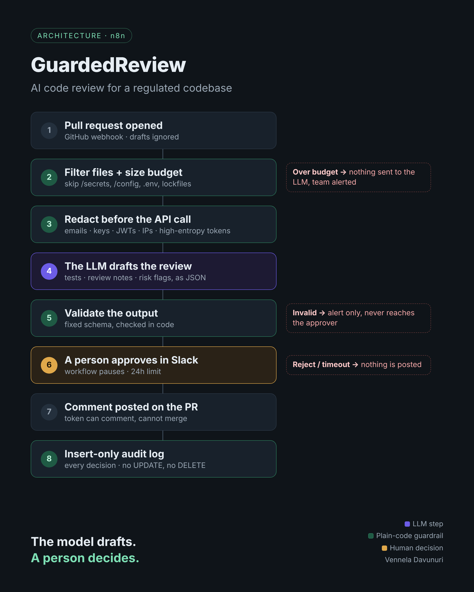
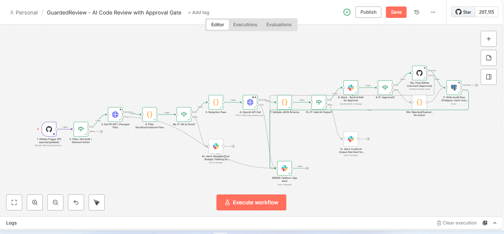
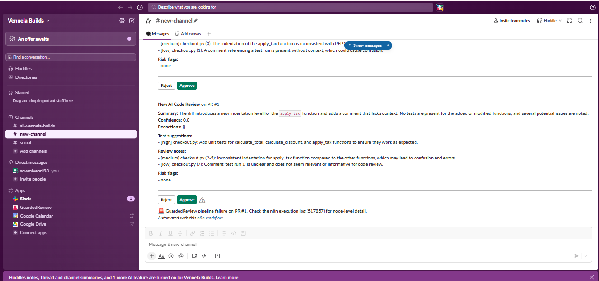
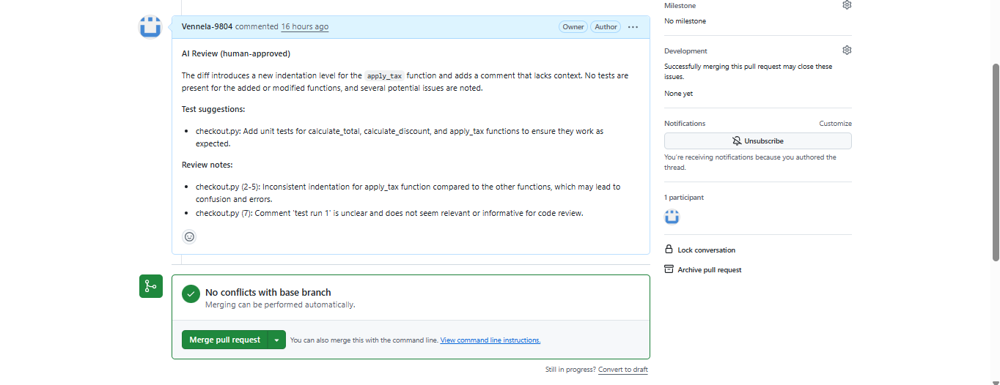

# GuardedReview

**AI code review for a regulated codebase. The model drafts. A person decides. Every decision is logged.**

Wiring "send the diff to an LLM, post its comments on the PR" takes an afternoon. In a bank or a healthcare company, that naive version fails in three ways:

1. **Sensitive data leaves the building.** Secrets, emails and internal hostnames in the diff go to a third-party API.
2. **Nobody approved what got posted.** The model comments directly on the pull request.
3. **Nobody can prove afterwards what happened.** There is no record of who decided what, or when.

GuardedReview is an n8n workflow that closes each of those gaps with plain-code guardrails and a human approval step.



## How it works

| Step | Node | What it does | Gap it closes |
|---|---|---|---|
| 1 | GitHub Trigger | Fires on pull request `opened`, `synchronize` or `ready_for_review`; drafts are ignored | |
| 2 | Filter files + size budget | Skips `/secrets`, `/config`, `.env`, lockfiles and build output; if the diff is over budget, nothing is sent and an alert goes out | Data leaving |
| 3 | Redaction pass | Replaces emails, key-shaped strings, JWTs, IPs and phone numbers, plus an entropy check for random-looking tokens | Data leaving |
| 4 | LLM call | The model gets the **redacted** diff only and is told never to guess what's behind a `[REDACTED_…]` placeholder; it must answer in a fixed JSON schema | |
| 5 | Validate output | Code checks the JSON schema; invalid output goes to an alert channel and never reaches the approver | Approval |
| 6 | Slack approval | The workflow pauses until a person clicks Approve or Reject (24-hour limit) | Approval |
| 7 | Post PR comment | Only approved reviews are posted; the GitHub token can comment but cannot merge | Approval |
| 8 | Audit log | Every decision is written to an insert-only Postgres table | Proof |

### Append-only is enforced by the database, not by convention

- The n8n database role can only `INSERT` and `SELECT`.
- A trigger rejects any `UPDATE`, `DELETE` or `TRUNCATE`, including from the admin account.
- Running an `UPDATE` returns: `audit_log is append-only: UPDATE is not allowed`.

## Test run

I tested it end to end on a separate sandbox repository. The test was a pull request adding `calculate_discount` and `apply_tax` to [`demo/checkout.py`](demo/checkout.py), with a deliberately fake API key and email planted in the code.

| | |
|---|---|
|  |  |
| Workflow run in n8n | Approval request in Slack |


*Approved review posted on the PR*

> **About the secret in `demo/checkout.py`:** `sk_test_FAKE1234567890ABCDEF` and `jane.doe@example-fake.com` are deliberately fake test values, planted to show the redaction step working. They are not real credentials.

## What it doesn't do yet

- **Redaction is regex plus entropy.** It won't catch a customer's name, free-text personal data, or an internal system that isn't on the deny list. This is the hardest gap and the next thing to work on.
- **One reviewer, no roles.** Anyone in the approval channel can approve. A production version would restrict approvers.
- **The approver's identity may not be captured.** Depending on the n8n version, the Slack approval step may not return who clicked; the audit row then records `not_captured`.

## Lesson from building it

In the first version, if the model returned broken JSON, the workflow still sent it to Slack for approval. The reviewer would have seen an empty message and might have clicked Approve anyway. Invalid output now goes to an alert channel instead. **A human checkpoint only works if what reaches the human is worth checking.**

## Set it up yourself

### What you need

- n8n (Cloud, or self-hosted with a public URL for the GitHub webhook)
- A GitHub fine-grained token scoped to one repo:
  - Pull requests: read and write
  - Contents: read
  - Webhooks: read and write
- A Slack workspace and bot. Create the app from [`slack/app-manifest.json`](slack/app-manifest.json).
- An OpenAI API key, with a low spend limit while testing
- A Postgres database. The Supabase free tier works.

### Steps

1. Run [`sql/audit_log.sql`](sql/audit_log.sql) in your database. Change the password first.
2. In n8n, create a workflow, open [`workflow/guardedreview-workflow.json`](workflow/guardedreview-workflow.json), copy everything, and paste it onto the canvas.
3. Replace the placeholders:
   - `YOUR_GITHUB_USERNAME_OR_ORG` and `YOUR_REPO_NAME` in node 1, pointing at the repo you want reviewed
   - `YOUR_SLACK_CHANNEL_ID` in four places
   - Copy `demo/checkout.py` into that repo if you want to reproduce the test
4. Add the credentials:
   - **GitHub** (nodes 1, 3, 10a)
   - **Header Auth** for OpenAI, with `Authorization: Bearer <key>` (node 6)
   - **Slack** bot token (nodes 4c, 7c, 8 and ERROR)
   - **Postgres** as `n8n_audit_writer` (node 11). On Supabase, use the session pooler, with the user `n8n_audit_writer.<project-ref>`.
5. Invite the bot to your Slack channel with `/invite @GuardedReview`.
6. Activate the workflow and open a pull request.

## Repository layout

```
guardedreview/
├── workflow/
│   └── guardedreview-workflow.json   n8n workflow (no credentials or account IDs)
├── sql/
│   └── audit_log.sql                 audit table, insert-only role, append-only triggers
├── slack/
│   └── app-manifest.json             Slack app definition
├── demo/
│   └── checkout.py                   test file with planted fake secrets
├── docs/
│   ├── architecture.png              flow diagram
│   └── screenshots/                  test-run screenshots
├── LICENSE
└── README.md
```

## Built by

Vennela Davunuri, AI Automation Engineer. I build AI agents and automation workflows with human-in-the-loop controls.
[LinkedIn](https://www.linkedin.com/in/venneladavunuri) · [Portfolio](https://portfolio-vennela3.vercel.app)

## License

MIT
# GuardedReview

**AI code review for a regulated codebase. The model drafts. A person decides. Every decision is logged.**

Wiring "send the diff to an LLM, post its comments on the PR" takes an afternoon. In a bank or a healthcare company, that naive version fails in three ways:

1. **Sensitive data leaves the building.** Secrets, emails and internal hostnames in the diff go to a third-party API.
2. **Nobody approved what got posted.** The model comments directly on the pull request.
3. **Nobody can prove afterwards what happened.** There is no record of who decided what, or when.

GuardedReview is an n8n workflow that closes each of those gaps with plain-code guardrails and a human approval step.


## How it works

| Step | Node | What it does | Gap it closes |
|---|---|---|---|
| 1 | GitHub Trigger | Fires on pull request `opened`, `synchronize` or `ready_for_review`; drafts are ignored | |
| 2 | Filter files + size budget | Skips `/secrets`, `/config`, `.env`, lockfiles and build output; if the diff is over budget, nothing is sent and an alert goes out | Data leaving |
| 3 | Redaction pass | Replaces emails, key-shaped strings, JWTs, IPs and phone numbers, plus an entropy check for random-looking tokens | Data leaving |
| 4 | LLM call | The model gets the **redacted** diff only and is told never to guess what's behind a `[REDACTED_…]` placeholder; it must answer in a fixed JSON schema | |
| 5 | Validate output | Code checks the JSON schema; invalid output goes to an alert channel and never reaches the approver | Approval |
| 6 | Slack approval | The workflow pauses until a person clicks Approve or Reject (24-hour limit) | Approval |
| 7 | Post PR comment | Only approved reviews are posted; the GitHub token can comment but cannot merge | Approval |
| 8 | Audit log | Every decision is written to an insert-only Postgres table | Proof |

### Append-only is enforced by the database, not by convention

- The n8n database role can only `INSERT` and `SELECT`.
- A trigger rejects any `UPDATE`, `DELETE` or `TRUNCATE`, including from the admin account.
- Running an `UPDATE` returns: `audit_log is append-only: UPDATE is not allowed`.

## Test run

I tested it end to end on a separate sandbox repository. The test was a pull request adding `calculate_discount` and `apply_tax` to [`checkout.py`](checkout.py), with a deliberately fake API key and email planted in the code.

| | |
|---|---|
|  |  |
| Workflow run in n8n | Approval request in Slack |



*Approved review posted on the PR*

> **About the secret in `checkout.py`:** `sk_test_FAKE1234567890ABCDEF` and `jane.doe@example-fake.com` are deliberately fake test values, planted to show the redaction step working. They are not real credentials.

## What it doesn't do yet

- **Redaction is regex plus entropy.** It won't catch a customer's name, free-text personal data, or an internal system that isn't on the deny list. This is the hardest gap and the next thing to work on.
- **One reviewer, no roles.** Anyone in the approval channel can approve. A production version would restrict approvers.
- **The approver's identity may not be captured.** Depending on the n8n version, the Slack approval step may not return who clicked; the audit row then records `not_captured`.

## Lesson from building it

In the first version, if the model returned broken JSON, the workflow still sent it to Slack for approval. The reviewer would have seen an empty message and might have clicked Approve anyway. Invalid output now goes to an alert channel instead. **A human checkpoint only works if what reaches the human is worth checking.**

## Set it up yourself

### What you need

- n8n (Cloud, or self-hosted with a public URL for the GitHub webhook)
- A GitHub fine-grained token scoped to one repo:
  - Pull requests: read and write
  - Contents: read
  - Webhooks: read and write
- A Slack workspace and bot. Create the app from [`app-manifest.json`](app-manifest.json).
- An OpenAI API key, with a low spend limit while testing
- A Postgres database. The Supabase free tier works.

### Steps

1. Run [`audit_log.sql`](audit_log.sql) in your database. Change the password first.
2. In n8n, create a workflow, open [`guardedreview-workflow.json`](guardedreview-workflow.json), copy everything, and paste it onto the canvas.
3. Replace the placeholders:
   - `YOUR_GITHUB_USERNAME_OR_ORG` and `YOUR_REPO_NAME` in node 1, pointing at the repo you want reviewed
   - `YOUR_SLACK_CHANNEL_ID` in four places
   - Copy `checkout.py` into that repo if you want to reproduce the test
4. Add the credentials:
   - **GitHub** (nodes 1, 3, 10a)
   - **Header Auth** for OpenAI, with `Authorization: Bearer <key>` (node 6)
   - **Slack** bot token (nodes 4c, 7c, 8 and ERROR)
   - **Postgres** as `n8n_audit_writer` (node 11). On Supabase, use the session pooler, with the user `n8n_audit_writer.<project-ref>`.
5. Invite the bot to your Slack channel with `/invite @GuardedReview`.
6. Activate the workflow and open a pull request.

## Repository layout

```
checkout.py                   test file with planted fake secrets
guardedreview-workflow.json   n8n workflow (no credentials or account IDs)
audit_log.sql                 audit table, insert-only role, append-only triggers
app-manifest.json             Slack app definition
architecture.png              flow diagram
01-, 02-, 03-*.png            test-run screenshots
```

## Built by

Vennela Davunuri, AI Automation Engineer. I build AI agents and automation workflows with human-in-the-loop controls.
[LinkedIn](https://www.linkedin.com/in/venneladavunuri) · [Portfolio](https://portfolio-vennela3.vercel.app)

## License

MIT
